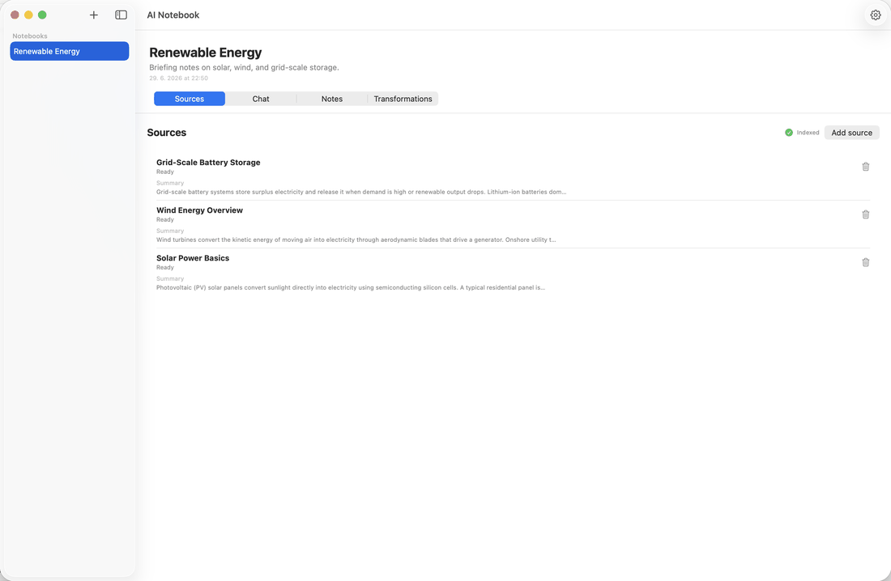
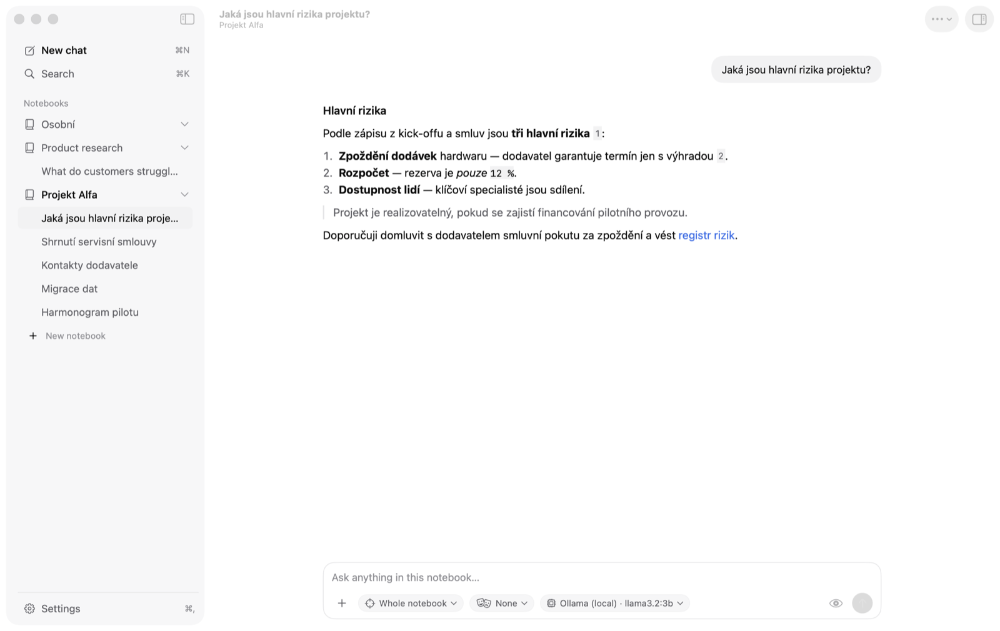
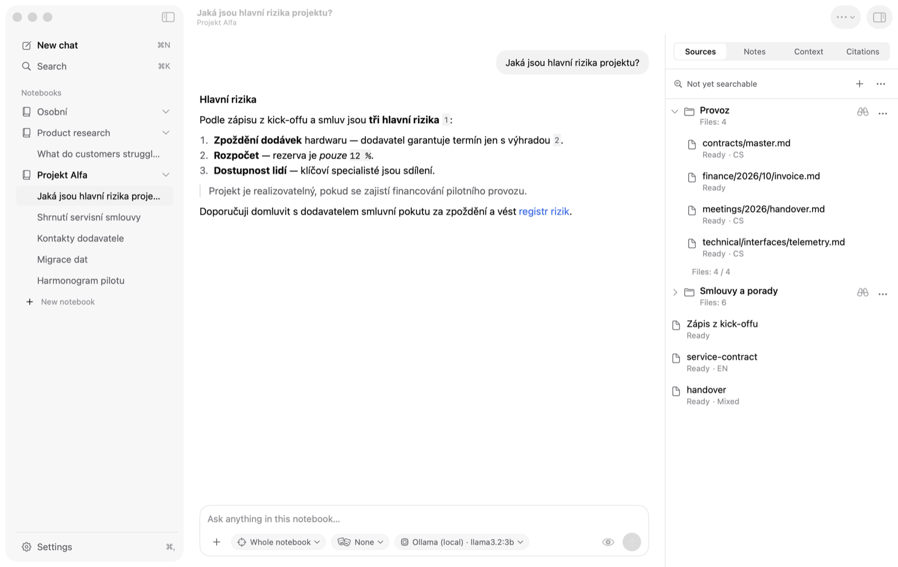
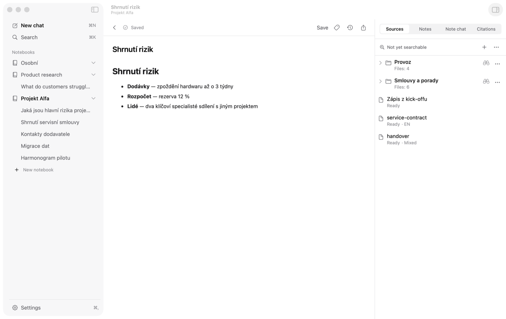
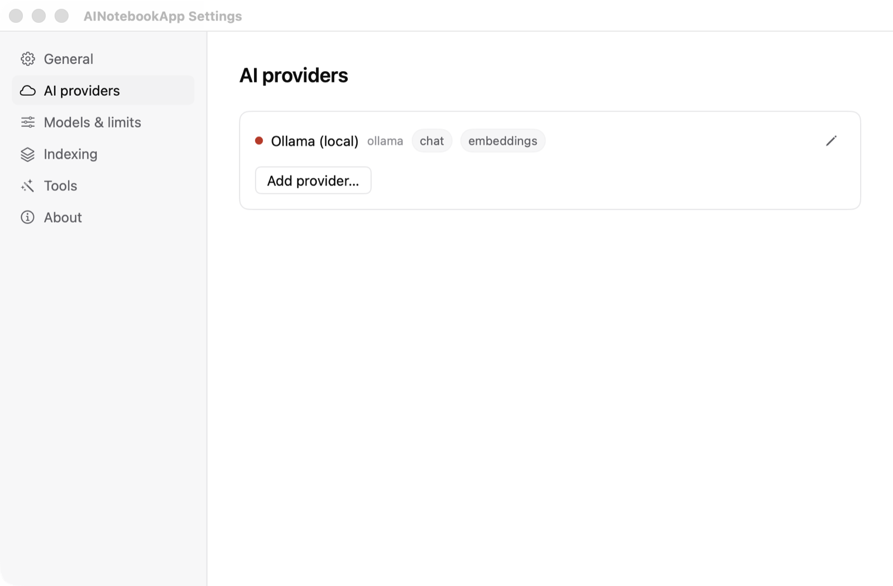

# AI Notebook

> A free, open-source, **offline alternative to Google NotebookLM** for
> **macOS** and **Windows**. Chat with your own PDFs, Office documents, and web
> pages and get answers with inline citations — privacy-first and local-first,
> with everything running on your machine. Powered by [Ollama](https://ollama.com);
> inspired by [open-notebook](https://github.com/lfnovo/open-notebook).

[](https://github.com/lukoplt/AI-notebook/releases/latest)
[](https://github.com/lukoplt/AI-notebook/releases)
[](https://github.com/lukoplt/AI-notebook/stargazers)

[](LICENSE)
[](https://github.com/lukoplt/AI-notebook/actions/workflows/core-ci.yml)
[](https://github.com/lukoplt/AI-notebook/actions/workflows/windows-ci.yml)

### 🌐 [Explore AI Notebook](https://lukoplt.github.io/AI-notebook/) · ⬇️ [Download the latest release](https://github.com/lukoplt/AI-notebook/releases/latest)

macOS `.dmg` · Windows `.exe`

If AI Notebook is useful to you, please ⭐ **star the repo** — it helps others find it.



---

## What is it?

AI Notebook is a native desktop app for **grounded research over your own
sources**. Drop in PDFs, Office documents, web pages, and plain text; the app
chunks and embeds everything **locally**, then lets you ask questions and get
answers with inline `[N]` citations that link straight back to the exact
snippet they came from.

The core idea: a NotebookLM-style workflow where **your documents never leave
your machine unless you explicitly choose a cloud model**. Embeddings,
retrieval, notes, and the database are all local. Both platforms stay
local-first with Ollama, and can optionally connect a cloud provider
(Anthropic, OpenAI), any OpenAI-compatible endpoint (e.g. LM Studio), or an
OpenWebUI server on your network when you want a stronger model.

It ships as two native codebases sharing one design and data model:

| Platform | Stack | AI providers |
|---|---|---|
| **macOS** 14+ | Swift 6 · SwiftUI | Ollama (local) · Anthropic · OpenAI · any OpenAI-compatible endpoint · OpenWebUI |
| **Windows** 10/11 | .NET 10 · WinUI 3 | Ollama (local) · Anthropic · OpenAI · any OpenAI-compatible endpoint · OpenWebUI |

---

## Why AI Notebook? (vs. Google NotebookLM)

|  | **AI Notebook** | Google NotebookLM |
|---|---|---|
| Where it runs | Your machine (native desktop app) | Cloud / browser |
| Your documents | Never leave your device (with Ollama) | Uploaded to Google |
| Works offline | ✅ Yes | ❌ No |
| Cost | Free & open source (MIT) | Free tier, Google account required |
| AI model | Local (Ollama) or bring your own key | Google models only |
| Platforms | Native macOS & Windows | Web only |

If you want NotebookLM-style "chat with your sources, get citations" but
**without sending your files to the cloud**, AI Notebook is built for that.

---

## Screenshots

*macOS app with the 0.15 redesign, showing demo notebooks (light mode; dark
mode and every surface in [`docs/design/screenshots/redesign/`](docs/design/screenshots/redesign/)).*

| Chat-first workspace with `[N]` citations | Right panel — Sources |
|:---:|:---:|
|  |  |
| **Note as a document — editor, history, Markdown/PDF export** | **Settings window** |
|  |  |

---

## Features

- **Chat-first workspace (new in 0.15)** — a calm, Codex-style layout on both
  platforms: notebooks and their chats in the sidebar (⌘N / Ctrl+N new chat,
  ⌘K / Ctrl+K search), the conversation in the middle with Markdown answers
  and a composer card (+ menu, scope / persona / model chips, context
  preview, Send that turns into **Stop** while an answer streams), and a
  collapsible right panel for Sources, Notes, Context and Citations. Notes open
  as full documents, Settings is its own window (macOS, ⌘,) or page
  (Windows), and chats can be renamed from the sidebar or the title bar.
- **Notebooks** — organise research into separate projects.
- **Sources** — ingest PDF, TXT, Markdown, web URLs, and Word / PowerPoint /
  Excel, or add a whole folder (see below). Each source is chunked and
  embedded locally. Excel workbooks are read as sheet names plus cell
  coordinates (`A1: …`); cached formula results and date serials are kept as
  annotated values — formulas are not evaluated and there is no OCR for
  scanned PDFs.
- **Chat with citations** — ask questions across your sources; answers stream
  in with clickable `[N]` chips that reveal the cited excerpt. Scope a chat to
  the whole notebook, or to any mix of folders, source sets and individual
  files.
- **Hybrid retrieval** — semantic search (cosine similarity over local
  embeddings) fused with keyword search (SQLite FTS5 / BM25) via Reciprocal
  Rank Fusion, so both meaning and exact terms are matched. Each branch
  fetches its own wider candidate pool (`fetchK`, 32) before the answer is cut
  to the passages that fit (`topK`, 16).
- **Notes** — a TipTap WYSIWYG editor with autosave, version history, and file
  attachments. Write by hand or save any AI answer as a note. Notes are
  auto-indexed and searchable alongside sources.
- **Transformations ("AI tools")** — run a prompt template over a source and
  store the result as a note. Built-in templates (Summary, Key points,
  Entities) plus your own custom prompts, with batch runs and history.
- **Follow-up suggestions & per-source summaries** — the chat surfaces
  suggested follow-up questions and one-line summaries for each source.
- **Multi-provider AI** — chat through Ollama, Anthropic, OpenAI, any
  OpenAI-compatible server or an OpenWebUI server on your network.
  Embeddings use embedding-capable providers only (Ollama, OpenAI,
  OpenAI-compatible); Anthropic and OpenWebUI are chat-only, and switching the
  chat provider never silently changes the embedding provider. Presets for
  common OpenAI-compatible servers (LM Studio, vLLM, OpenRouter, Groq,
  Mistral, Together), a manual model ID when a server cannot list its models,
  and per-model context / output-token limits. Keys are stored in the OS
  credential vault (macOS Keychain / Windows Credential Manager), never in the
  database.
- **Optional web search** — opt-in web results injected as user-message
  context (kept out of the system prompt to limit prompt injection).
- **Export / import / backup** — export a single note to Markdown or a whole
  notebook to a ZIP archive; back up and restore the full database.
- **Global search, tags, source sets & personas** — search across all
  notebooks, tag sources, save reusable source sets for scoped chat, and keep
  named presets of instructions, sources and model.
- **Bilingual UI** — English and Czech. The app starts in English; switch the
  language in Settings. (UI language is independent of the document languages
  detected below.)

### Folder chat and multilingual evidence

Add a folder once and it stays part of the notebook: it can be watched for
changes, rescanned on demand ("Scan now" / "Verify all") and is reconciled
after a restart. Folder rules control included file types, ignored paths,
extraction limits and a Windows-1250 fallback for legacy Czech text files.
Coverage shows searchable files separately from pending or failed refreshes,
skipped and missing files, and the Sources list groups files under their
folder.

AI Notebook detects **Czech, Slovak, English and German** locally (a small
bundled model, no network). Before each answer it prepares a *context pack*:
scope and coverage, a relative-path map of the folder, the cited excerpts
labelled with their language, your instructions and the question. The
**context preview** shows exactly what will be sent, and **Overview** gives an
explicitly sampled, excerpt-based view of a folder rather than an exhaustive
summary. Saved citations keep their full excerpt and document revision, so
they stay readable after a restart or after the original file changes or is
deleted. Re-indexing with a different embedding model builds a replacement
index while the active one keeps answering.

> **Platform parity:** macOS and Windows ship the same feature set and, since
> the 0.15 redesign, the same layout and strings — including folder chat and
> note export to PDF on both platforms (see [`docs/roadmap.md`](docs/roadmap.md)). Release verification checklists live
> in [`docs/release/`](docs/release/); retrieval evaluation notes in
> [`docs/eval/README.md`](docs/eval/README.md).

---

## Privacy

Everything runs on your machine by default:

- Source text, chunks, embeddings, notes, and chat history live in a single
  local SQLite database.
- API keys for cloud/network providers are stored in the OS credential vault
  (macOS Keychain / Windows Credential Manager), not in the database or in
  plain text.
- The **only** outbound network calls are ones you initiate: fetching a web
  URL you add as a source, an optional once-a-day update check against
  api.github.com (toggleable in Settings, carries no personal data),
  optional web search, and requests to a cloud or network AI provider you
  explicitly configure and consent to.
- With Ollama as the provider, the app makes **no AI calls off your device**.

---

## Install

### macOS

Download the latest `AINotebook-vX.Y.Z-macos.dmg` from
[Releases](https://github.com/lukoplt/AI-notebook/releases), open it, drag
**AI Notebook** to Applications, and launch. The first run walks you through
Ollama detection and model download.

**Requirements**

- macOS 14 (Sonoma) or later
- [Ollama](https://ollama.com/download) (the app guides you through setup on
  first launch)
- ~5 GB free disk for the default models (`llama3.2:3b` + `nomic-embed-text`)

### Windows

Download the latest `AINotebook-vX.Y.Z-windows-setup.exe` from
[Releases](https://github.com/lukoplt/AI-notebook/releases) and run the
installer. The build is self-contained; the WebView2 runtime is installed
automatically if missing.

**Requirements**

- Windows 10 (1809+) or Windows 11
- For local AI: [Ollama](https://ollama.com/download). For cloud AI: an API key
  for your chosen provider (Anthropic / OpenAI / OpenAI-compatible).

### First launch: "unknown / unidentified developer"

The release binaries are **not signed with a paid Apple/Microsoft developer
certificate**, so the OS shows a warning the first time you open the app. This
is expected for an open-source build — you can verify the source here and build
it yourself. To run the downloaded release:

**macOS** — Gatekeeper blocks it with *"AI Notebook can't be opened because
Apple cannot check it for malicious software"* (or *"unidentified developer"*).

1. In **Finder**, right-click (or Control-click) **AI Notebook** in
   Applications → **Open**, then confirm **Open** in the dialog. macOS
   remembers the choice for next time.
2. If there's no **Open** button, go to  **System Settings → Privacy &
   Security**, scroll to the message about AI Notebook, and click
   **Open Anyway**.
3. Stubborn quarantine flag? Clear it in Terminal:
   ```bash
   xattr -dr com.apple.quarantine "/Applications/AI Notebook.app"
   ```

**Windows** — SmartScreen shows *"Windows protected your PC"* with
*"Unknown publisher"*.

1. Click **More info**.
2. Click **Run anyway** to launch the installer.
3. If a User Account Control prompt names an unknown publisher, confirm
   **Yes** to continue.

### Verify your download (build provenance)

The releases aren't signed with a paid certificate, but every release
artifact carries a **GitHub build-provenance attestation** (signed via
[Sigstore](https://www.sigstore.dev/), recorded in a public transparency log).
It cryptographically proves the file was built by this repo's release workflow
and not tampered with. With the [GitHub CLI](https://cli.github.com/):

```bash
gh attestation verify AINotebook-v0.8.1-macos.dmg --repo lukoplt/AI-notebook
# or, on Windows:
gh attestation verify AINotebook-v0.8.1-windows-setup.exe --repo lukoplt/AI-notebook
```

A successful check confirms the binary's origin. (This does not remove the OS
first-launch warning above — only a paid Apple/Microsoft certificate does that.)

---

## Build from source

### macOS

```bash
git clone https://github.com/lukoplt/AI-notebook
cd AI-notebook
swift run AINotebookApp
```

Requires **Xcode 16+** (Swift 6).

### Windows

```powershell
git clone https://github.com/lukoplt/AI-notebook
cd AI-notebook
dotnet restore windows/AINotebook.sln --locked-mode
dotnet build windows/AINotebook.sln -c Release
```

Requires the **.NET 10 SDK** and the Windows App SDK / WinUI 3 workload.
NuGet dependencies are pinned via `packages.lock.json` — restore in locked
mode so a drifting lockfile fails the build. See
[`docs/windows-build.md`](docs/windows-build.md) for packaging the installer.

---

## Architecture

A shared design and data model implemented natively per platform.

**macOS** (`Sources/`)

- `AINotebookCore` — Swift Package library: SQLite storage (GRDB), Ollama
  client, ingestion, embedder, hybrid retriever, chat engine, transformations.
- `AINotebookApp` — SwiftUI executable.
- Database: `~/Library/Application Support/AINotebook/db.sqlite`.

**Windows** (`windows/`)

- `AINotebook.Core` — .NET class library: extractors, ingestion, RAG pipeline,
  Dapper/SQLite storage, Ollama client, and the multi-provider router
  (Anthropic, OpenAI, OpenAI-compatible) with a Credential-Manager-backed key
  store.
- `AINotebook.App` — WinUI 3 app (WebView2-hosted TipTap editor).

**Shared model** — one SQLite schema with identical feature migrations on both
platforms (currently through v19: persisted folders, document revisions,
durable ingestion jobs and versioned embedding generations), hybrid retrieval
(cosine + FTS5 BM25 → Reciprocal Rank Fusion), and an EN/CS localization layer
whose keys are kept identical across platforms by tests. Shared behaviour is
pinned by JSON contract fixtures in `Tests/fixtures/` that both test suites
execute.

The full design spec lives in
[`docs/superpowers/specs/`](docs/superpowers/specs/); the development roadmap is
in [`docs/roadmap.md`](docs/roadmap.md).

---

## Project layout

```
Sources/            macOS — Swift / SwiftUI app + AINotebookCore library
Tests/              macOS — Swift unit tests
windows/            Windows — .NET 10 / WinUI 3 solution
  src/AINotebook.Core    shared-design core (storage, RAG, providers)
  src/AINotebook.App     WinUI 3 application
  tests/                 .NET unit tests
  installer/             Inno Setup script + redistributables
docs/               design spec, roadmap, build notes
.github/workflows/  CI + release pipelines (macOS & Windows)
```

---

## Contributing

Issues and pull requests are welcome. Both platforms are covered by CI
(`core-ci`, `windows-ci`) on every push — please make sure tests pass and, on
Windows, that the NuGet lockfile stays in sync (`--locked-mode`).

---

## License

MIT — see [LICENSE](LICENSE) and [NOTICE](NOTICE).

Inspired by [open-notebook](https://github.com/lfnovo/open-notebook) (MIT).
Built with GRDB.swift, SwiftSoup, ZIPFoundation (macOS) and AngleSharp, Dapper,
PdfPig, WebView2, Windows App SDK (Windows). Local AI powered by
[Ollama](https://ollama.com).

Made with ❤️ by Lukáš Oplt.
